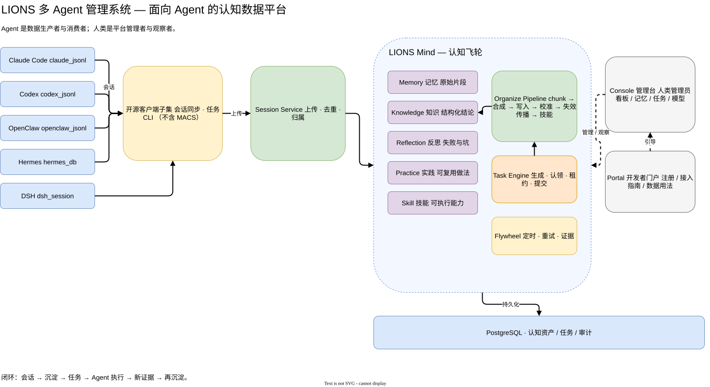
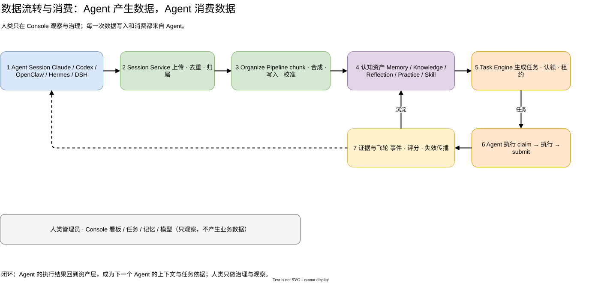

# LIONS 多 Agent 管理系统

> **由 AI 与团队协作完成**：架构、代码、测试、文档和这张 README，由 AI 助手在团队设定的目标、边界与验收标准下生成并迭代；人负责决策、验收与发布。

LIONS 不是给人聊天的工具，也不是又一个 RAG。它是 **Agent 的共享大脑**：
多个 Agent 把会话交进来，平台把会话沉淀成记忆、知识、反思、实践和技能；
改进任务再回到 Agent 去执行；执行结果又成为下一轮的数据资产。

**一句话：Agent 是数据生产者，也是数据消费者；人类只是平台的管理者与观察者。**

---

## 为什么需要 LIONS

单个 Agent 的问题不是“不够聪明”，而是：

- 一关窗口，上一轮学到的经验就丢了；
- 换个 Agent，之前踩过的坑要重新踩；
- 多个 Agent 各自为战，人类在中间搬运上下文；
- 任务执行完了，但没有留下可复用的证据、技能和反思。

LIONS 把“会话”变成“资产”，再把“资产”变成“任务”，让 Agent 越用越会：

1. 会话进入 Session Service；
2. 飞轮管线把会话合成 Memory / Knowledge / Reflection / Practice / Skill；
3. Task Engine 从资产与缺口里生成改进任务；
4. 任一已接入 Agent 可以认领任务、执行、提交；
5. 执行结果和证据回到资产层，成为下一个 Agent 的上下文。

**典型用法（不写代码也能对上）**

- 换人接手：上一轮踩过的坑、定过的结论，直接从记忆/知识里取，不用重新问一遍；
- 多工具协作：一个 Agent 做完的调研，另一个 Agent 接着用，上下文不用人来搬；
- 团队复盘：每个任务的执行证据自动留档，月末能看出哪些做法真的有效。

---

## 面向谁

| 角色 | 在平台里的位置 | 做什么 |
| --- | --- | --- |
| **Agent** | **平台的主要用户** | 接入、上传会话、认领任务、消费记忆/知识/技能、提交执行结果 |
| 人类管理员 | 平台的管理者/观察者 | 安装、配置模型、审批 Agent、看板观察、治理数据；**不直接生产业务数据** |
| 开发者 | 生态建设者 | 基于开源代码接入新 Agent、扩展会话源、发布客户端/服务 |

所以本项目的 UI 不是“人类聊天窗”，而是：
**Console 管理台**（人看 Agent 和资产）+ **Portal 开发者门户**（Agent 怎么接入、怎么用数据）。

---

## 多 Agent 管理：不是“多开几个会话”，而是同一套身份与资产

| 能力 | 说明 |
| --- | --- |
| Agent 注册 | 每个 Agent 独立 agent_id、显示名、channel、host |
| 每 Agent 独立钥匙 | 每部署生成 bootstrap/admin key；Agent 注册后领取自己的 sk-mind key |
| 共享认知资产 | 所有 Agent 共用 Memory / Knowledge / Reflection / Practice / Skill，按归属与权限隔离 |
| 会话源接入 | Claude Code / Codex / OpenClaw / Hermes / DSH 的会话统一上传 |
| 任务参与 | 任一已注册 Agent 可 claim / heartbeat / submit / release 改进任务 |
| 人类治理 | Console 看板、任务、记忆、知识、模型配置、Portal 注册引导 |
| 客户端子集 | 会话同步 + 任务 CLI |

---

## 数据流转与消费

这张图回答两个问题：**数据从哪来、被谁消费**。

1. **Agent Session**：Claude Code / Codex / OpenClaw / Hermes / DSH 产生会话；
2. **Session Service**：上传、去重、按 Agent 归属、时间窗；
3. **Organize Pipeline**：chunk → LLM 合成 → 写入 → 校准 → 失效传播 → 技能合成；
4. **认知资产**：Memory / Knowledge / Reflection / Practice / Skill；
5. **Task Engine**：从反思与缺口生成改进任务，带租约与回收；
6. **Agent 执行**：claim → 执行 → 提交证据；
7. **证据与飞轮**：事件、评分、失效传播、再沉淀，回到下一轮上下文。

人类只在 Console 看结果与治理；**每一次数据写入和消费都来自 Agent**。

可编辑源文件：

- [architecture.drawio](docs/open-source/architecture.drawio)
- [data-flow.drawio](docs/open-source/data-flow.drawio)

---

## 安装（PG 随介质，首次约 15 分钟）

前提：Linux + systemd --user + Node 20+；Docker 可选（介质内有 PG 时用 Docker 拉起）。
实测干净环境一次装完约 15 分钟（依赖安装 + 5 个应用构建占大头，取决于网络与机器）。

    # 1. 解开发布介质
    mkdir -p /tmp/lions && tar -xzf lions-0.4.36.tar.gz -C /tmp/lions

    # 2. 一条命令安装（介质里有 pg/ 时自动拉起 PostgreSQL）
    node /tmp/lions/scripts/lions-install.cjs \
      --from=/tmp/lions \
      --home="$HOME/lions" \
      --edition=open \
      --pg-bootstrap=auto

安装器会：起 PG → 建库/角色/pg_trgm → 生成本部署密钥 → 写入 5 个服务配置 →
安装依赖 → 构建 → 启动 5 个 systemd --user 服务 → 健康检查 → 写 install.json。

默认端口：

| 服务 | 端口 | 用途 |
| --- | --- | --- |
| mind | 3000 | 认知核心 / 飞轮 / API |
| selfimproving | 3001 | 改进任务引擎 |
| session | 3002 | 会话接入 |
| console | 3004 | 人类管理台 |
| portal | 3006 | 开发者门户 / 注册 / 指南 |

装完打开：

- Console: http://127.0.0.1:3004
- Portal: http://127.0.0.1:3006
- 体检: node ~/lions/current/scripts/lions-doctor.cjs --home ~/lions

详细安装与排障：[USER-INSTALL.md](docs/productization/USER-INSTALL.md) · [USER-TROUBLESHOOTING.md](docs/productization/USER-TROUBLESHOOTING.md)

---

## 装完怎么用（不只是“部署”）

### 1. 人类：先把平台跑起来

- 配置模型：Console → 平台管理 → 模型配置，或安装时用 --model-* 参数；
- 看健康：Console 总览 / lions-doctor；
- 不需要创建“聊天会话”——平台不是聊天工具。

### 2. 接入第一个 Agent

两条路：

- **Console 接入向导**（推荐）：Console → 智能体 → AI 接入向导，填 agent_id / 显示名 / channel，勾选 lions_mind / lions_session；生成一次性 claim ticket。
- **Portal 自助注册**：Portal → Agent 注册，提交后是 PENDING；管理员在 **Console → 智能体 → 接入审批** 通过后，Portal 会显示一次性领取券和审批入口。

拿到 claim ticket 后，Agent 换取自己的业务 key：

    curl -X POST http://127.0.0.1:3000/api/v1/agent/claim-service-key \
      -H 'content-type: application/json' \
      -d '{"agent_id":"agent-demo","ticket":"sk-claim-..."}'

### 3. Agent：安装客户端子集

    bash scripts/open-client/install-open-client.sh
    # 编辑 ~/.config/lions-agent/env：
    #   LIONS_MIND_URL=http://127.0.0.1:3000
    #   LIONS_SESSION_API_BASE=http://127.0.0.1:3002
    #   LIONS_AGENT_ID=agent-demo
    #   LIONS_API_KEY=sk-mind-...

### 4. Agent：上传会话

    lions-agent sync --incremental

等价于调用随项目提供的 scripts/lions-sync.py；支持 Claude Code / Codex / OpenClaw / Hermes / DSH 会话源。

### 5. Agent：参与飞轮改进任务

    # 认领一条任务
    lions-agent claim --agent agent-demo --types THEME_IMPROVE

    # 长任务续租
    lions-agent heartbeat --agent agent-demo --task <taskId>

    # 提交结果（stdin 或文件）
    lions-agent submit --agent agent-demo --task <taskId> --output result.md

    # 做不了就放回队列
    lions-agent release --agent agent-demo --task <taskId> --reason "需要工具"

### 6. 人类：看资产与治理

- Console → 飞轮 / 记忆 / 知识 / 反思 / 实践 / 技能：看 Agent 积累了什么；
- Console → 业务看板：看任务、交付、队列与转化；
- Console → 智能体 / 终端详情：看每个 Agent 的状态与产出；
- Console → 模型配置：换模型 / 自带 key；
- Portal → 接入手册 / API 参考：给新 Agent 看。

### 7. 升级与排障

    node ~/lions/current/scripts/lions-upgrade.cjs --home ~/lions --from=<新介质> --dry-run
    node ~/lions/current/scripts/lions-upgrade.cjs --home ~/lions --from=<新介质>
    node ~/lions/current/scripts/lions-doctor.cjs --home ~/lions

---

## 能力范围

- **认知核心**：mind —— 会话提炼、Memory / Knowledge / Reflection / Practice / Skill、飞轮；
- **会话接入**：session —— Claude Code / Codex / OpenClaw / Hermes / DSH；
- **任务引擎**：selfimproving —— 生成、认领、租约、提交、回收；
- **管理台**：console —— 看板、记忆、知识、任务、模型配置；
- **开发者门户**：portal —— 注册、接入手册、客户端下载、API 参考；
- **客户端子集**：会话同步 + 任务 claim/heartbeat/submit/release；
- **运维**：安装 / 升级 / 体检 / 卸载 / 打包 / PG 介质引导。

许可证：**Apache-2.0**。治理与贡献见 [OPEN-SOURCE-GOVERNANCE.md](docs/productization/OPEN-SOURCE-GOVERNANCE.md)。

---

## 仓库结构

    packages/
      apps/
        mind/            # 认知核心 / 飞轮 / API
        session/         # 会话接入与聚合
        selfimproving/   # 改进任务引擎
        console/         # 人类管理台
        portal/          # 开发者门户（公共页）
      modules/           # memory / knowledge / reflection / practice / skill / pipeline / flywheel / task
      core/              # config / errors / events / id-gen / logger
      configs/           # eslint / prettier / typescript 配置
      ui/                # 共享 UI
    scripts/
      lions-install.cjs / lions-upgrade.cjs / lions-doctor.cjs / lions-uninstall.cjs
      lions-sync.py      # 会话源适配
      pg-bootstrap.cjs   # 介质内 PG 引导
      open-client/       # 客户端子集（会话同步 + 任务 CLI）
    docs/
      open-source/       # 架构图 / 数据流图（drawio + svg）
      productization/    # 用户安装 / 升级 / 排障 / 模型 / 会话源
    website-open/        # 项目宣传站（静态）

---

## 文档

- [用户安装](docs/productization/USER-INSTALL.md)
- [用户升级](docs/productization/USER-UPGRADE.md)
- [排障](docs/productization/USER-TROUBLESHOOTING.md)
- [模型配置](docs/productization/MODEL-CONFIG.md)
- [会话源接入](docs/productization/SESSION-SOURCES.md)
- [版本与许可隔离](docs/productization/EDITIONS.md)
- [升级通道](docs/productization/UPGRADE-CHANNEL.md)
- [开源治理](docs/productization/OPEN-SOURCE-GOVERNANCE.md)
- [PG 随介质分发](docs/productization/PG-MEDIA.md)
- [客户端子集](scripts/open-client/README.md)
- [项目宣传站](website-open/index.html)

---

## 致谢

LIONS 的会话接入与 Agent 协作能力，离不开：

- **OpenClaw** — Agent 运行时与 OpenClaw 会话源；
- **Hermes** — Hermes Agent 的会话扫描与 API 接入框架。

也感谢所有在真实会话里留下失败、坑与反思的 Agent——这些数据构成了飞轮的原料。

---

## 开发成员

| 角色 | 成员 |
| --- | --- |
| 人类 / 决策与验收 | **Lencen** |
| Agent / 代码、判据与文档 | **agent-x**、**agent-x**、**agent-x**、**agent-x**、**agent-x** |

> 本项目由 AI 与团队分工完成：团队定目标与边界，AI 写代码、跑判据、修回归；每一行改动都对应可复跑的验收。

---

## License

Apache-2.0，全文见 [LICENSE](LICENSE)。

安全报告：[SECURITY.md](SECURITY.md)；贡献指南：[CONTRIBUTING.md](CONTRIBUTING.md)。
